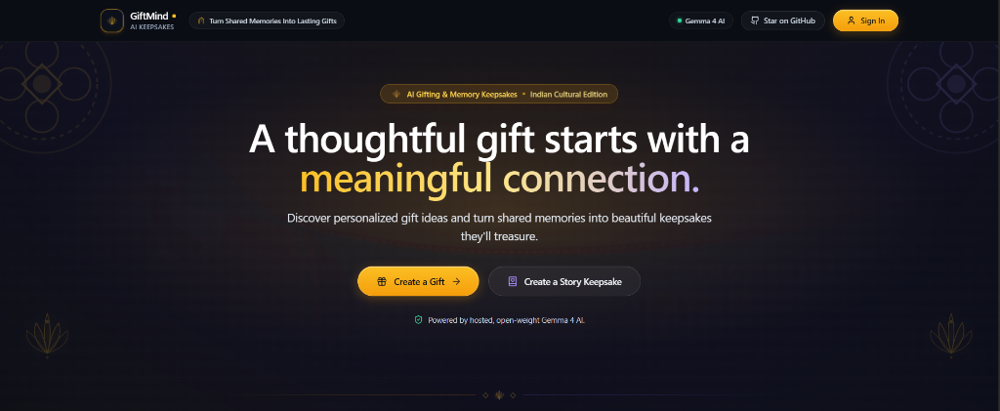

# GiftMind

> **Turn Shared Memories Into Lasting Gifts.**

<div align="center">
  
</div>

An open-source AI gifting platform that curates thoughtful, budget-aware gift recommendations and transforms cherished personal memories into downloadable story keepsake PDFs.

Developed for **Hacktoberfest 2026 Week 2** using production-grade software engineering standards.

---

## 🌟 Why GiftMind Exists

Choosing gifts often defaults to impersonal gift cards or rushed online browsing. Meaningful gifts, however, originate from personal history: the in-jokes, shared triumphs, obstacles overcome together, and heartfelt appreciation.

**GiftMind** bridges the gap between deep emotional memory and actionable gifting:
1. **AI Gift Ideas**: Analyzes a recipient's unique personality, quirks, occasion, and exact budget constraints to curate three distinct, creative gift concepts with presentation guidance.
2. **Story Keepsake**: Guides users through a structured 5-question memory interview, synthesizes an authentic narrative using hosted open-weight **Gemma 4**, allows full in-browser editing, and generates an archival-grade, print-ready PDF keepsake.

---

## 📸 Screenshots & Showcase

<p align="center">
  
</p>

| View | Description | Preview |
|---|---|---|
| **Heritage Landing & Hero** | Full-width Indian cultural artwork blend with lotus and mandala motifs | [View Screenshot](docs/images/giftmind_hero_screenshot.png) |
| **Unified Keepsake Studio** | Dual-pathway showcase for AI Gift Ideas and Story Keepsake | Interactive Next.js 15 App Router |
| **Guided Memory Interview** | 5 canonical reflection prompts capturing authentic relationship context | Real-time word counter & validation |
| **Story Editor & Archival PDF** | Full text review, custom dedication, and in-memory ReportLab PDF export | Downloadable vector PDF |

> *Interactive Demo URL & Video Walkthrough:*
> - **Live Demo**: `[Demo URL Placeholder — Deployment Pending]`
> - **Video Walkthrough**: `[Demo Video Placeholder — Recording Pending]`

---

## 🚀 Features & Implementation Status

Features across all development phases are **fully implemented and verified**:

### ✅ Phase 1: Production-Grade Project Foundation
- [x] **Monorepo Architecture**: Clean separation between `backend/` (FastAPI), `frontend/` (Next.js 15), `docs/`, and container infrastructure.
- [x] **FastAPI Application Factory**: Structured configuration with `pydantic-settings`, async lifespan management, CORS filtering, and centralized error handling.
- [x] **Health Check Endpoint**: Available at `GET /health` returning `{ "status": "ok", "service": "giftmind-api" }`.
- [x] **Database Engine & Session Layer**: SQLAlchemy 2.x async engine with `asyncpg`, connection pooling, and dependency injection (`get_db`).
- [x] **Alembic Async Migrations**: Migration environment wired to application settings and `Base.metadata` autogeneration.

### ✅ Phase 2: Core Domain & Secure Authentication
- [x] **Authentication & Token Management**:
  - Argon2id password hashing via `argon2-cffi`.
  - Short-lived JWT access tokens and long-lived refresh tokens stored server-side with SHA-256 hash.
  - HttpOnly and SameSite cookie transport for refresh tokens with rotation and revocation protection.
  - Double-Submit CSRF cookie verification on state-changing endpoints.
  - Endpoints: `POST /api/v1/auth/register`, `POST /api/v1/auth/login`, `POST /api/v1/auth/refresh`, `POST /api/v1/auth/logout`, `GET /api/v1/users/me`.
- [x] **Recipient CRUD & Ownership Isolation**:
  - Strict tenant isolation scoped to authenticated `user_id`.
  - Paginated list endpoints with deterministic ordering.
  - Endpoints: `POST /api/v1/recipients`, `GET /api/v1/recipients`, `GET /api/v1/recipients/{id}`, `PUT /api/v1/recipients/{id}`, `DELETE /api/v1/recipients/{id}`.
- [x] **Gift Project Management**:
  - Foreign key integrity linking users and recipients.
  - Budget constraint validation (`budget_min >= 0`, `budget_max >= budget_min`).
  - Endpoints: `POST /api/v1/gift-projects`, `GET /api/v1/gift-projects`, `GET /api/v1/gift-projects/{id}`, `PUT /api/v1/gift-projects/{id}`, `DELETE /api/v1/gift-projects/{id}`.

### ✅ Phase 3: AI Gift Recommendations Engine
- [x] **Hosted Gemma 4 26B via Google Gemini API**:
  - Abstract AI provider interface (`AIProvider`) decoupling business logic from inference backend.
  - Integration with open-weight **Gemma 4 26B A4B** (`gemma-4-26b-a4b-it`) hosted on Google Gemini API infrastructure via official `google-genai` SDK.
  - Hardened prompt synthesis with `<untrusted_user_notes>` boundary encapsulation against prompt injection.
  - Strict JSON schema enforcement delivering exactly 3 distinct, budget-aligned recommendations with personalized rationale and presentation ideas.
  - Atomic generation slot claim backed by PostgreSQL partial unique index (`uq_gift_recommendation_generations_project_pending`), preventing race conditions.
  - Endpoints: `POST /api/v1/gift-projects/{id}/recommendations/generate`, `GET /api/v1/gift-projects/{id}/recommendations`.

### ✅ Phase 4: Guided Memory Interview, Story Keepsakes & PDF Generation
- [x] **Guided Memory Interview**:
  - 5 canonical reflection questions (`how_we_met`, `favorite_memory`, `what_makes_them_special`, `shared_milestone`, `gift_feeling`).
  - Minimum sufficiency threshold validation (requires at least 2 questions with 10+ words each).
  - Endpoints: `GET /api/v1/gift-projects/{id}/memories`, `PUT /api/v1/gift-projects/{id}/memories`.
- [x] **AI Story Synthesis**:
  - Synthesizes long-form narrative stories (350–550 words), personalized dedications, and closing blessings.
  - In-browser editable story workspace with live word count tracking.
  - Endpoints: `POST /api/v1/gift-projects/{id}/story/generate`, `GET /api/v1/gift-projects/{id}/story`, `PUT /api/v1/gift-projects/{id}/story`.
- [x] **Archival In-Memory PDF Generation**:
  - Server-side PDF generation using ReportLab (`SimpleDocTemplate`, `Paragraph`, `Spacer`, `KeepTogether`).
  - Strict pagination (2-page layout), elegant margins, custom typography, and warm header accents.
  - Zero disk leaks: generates in-memory via `io.BytesIO` streamed with `application/pdf` and `Content-Disposition`.
  - Endpoint: `GET /api/v1/gift-projects/{id}/story/pdf`.

### ✅ Phase 5: Modern SaaS Redesign & Cultural Aesthetics
- [x] **Next.js 15 App Router Frontend**:
  - TypeScript in strict mode, Tailwind CSS v3 dark luxury palette, and Lucide React iconography.
  - Full-width hero section blending Indian cultural heritage artwork with lotus and mandala motifs.
  - Unified 2-in-1 experience showcase eliminating fragmented boxes.
  - Glassmorphic navigation header with Gemma 4 trust badge.

---

## 🛠️ Technology Stack

| Layer | Technologies |
|---|---|
| **Backend** | Python 3.12+, FastAPI, Pydantic v2, `pydantic-settings`, SQLAlchemy 2.x (async), `asyncpg`, PostgreSQL 16, Alembic, ReportLab, PyPDF, Ruff, Pytest, HTTPX |
| **Frontend** | Next.js 15 (App Router), TypeScript (Strict Mode), Tailwind CSS v3, React 18, Lucide React |
| **AI Inference** | Open-Weight **Gemma 4 26B A4B** (`gemma-4-26b-a4b-it`) hosted via Google Gemini API (`google-genai` SDK) |
| **Infrastructure & CI** | Docker Compose, PostgreSQL 16, GitHub Actions CI |

---

## 💡 Open-Weight Innovation & Side-Hustle Potential

### Why Hosted Open-Weight Gemma 4?
Many AI applications rely exclusively on proprietary, black-box closed models. GiftMind leverages Google's open-weight **Gemma 4 26B A4B** hosted on Gemini API infrastructure:
- **Open-Weight Transparency**: Inspectable architecture, open weights, and reproducible prompting.
- **Zero Local GPU Overhead**: Fast cloud inference without needing local daemon setups (like Ollama) or expensive dedicated GPUs.
- **High-Throughput Free Tier**: 30 Requests Per Minute (RPM) and 14,400 Requests Per Day (RPD) enable friction-free development and showcase demos.

### Side-Hustle Business Use Case
GiftMind provides a turnkey digital product foundation for independent creators and artisanal gifting businesses:
1. **Curated Keepsake Books**: Offer personalized anniversary or birthday keepsake PDFs printed on premium linen cardstock.
2. **Corporate Milestones**: Curate thoughtful retirement, promotion, or farewell gifts combining personalized physical recommendations with commemorative narrative storybooks.
3. **White-Label Keepsakes**: Extend the open-weight prompt framework to craft bespoke wedding vow books, graduation tributes, or family legacy memoirs.

---

## ⚡ Local Development Setup

### Prerequisites
- **Python**: 3.12 or higher
- **Node.js**: 20 or higher (with npm)
- **Docker**: Docker & Docker Compose (or local PostgreSQL 16)

---

### 1. Database Setup (Docker Compose)

Start the local PostgreSQL container:
```bash
docker compose up -d
```

Verify that the database is healthy on port `5432`:
```bash
docker compose ps
```

---

### 2. Backend Setup

1. Navigate to the backend directory and activate your virtual environment:
   ```bash
   cd backend
   python3 -m venv .venv
   source .venv/bin/activate
   ```

2. Install dependencies:
   ```bash
   pip install -e ".[dev]"
   ```

3. Create the local environment file:
   ```bash
   cp .env.example .env
   ```

4. Configure your Google AI Studio API key in `backend/.env`:
   ```bash
   AI_PROVIDER=google
   GOOGLE_API_KEY=your_google_api_key_here
   GEMMA_MODEL=gemma-4-26b-a4b-it
   ```

5. Run database migrations:
   ```bash
   alembic upgrade head
   ```

6. Start the FastAPI development server:
   ```bash
   uvicorn app.main:app --reload --port 8000
   ```

The backend is available at:
- **API Base**: `http://localhost:8000`
- **Health Check**: `http://localhost:8000/health`
- **Interactive OpenAPI Documentation**: `http://localhost:8000/api/v1/docs`

---

### 3. Frontend Setup

1. Navigate to the frontend directory:
   ```bash
   cd frontend
   ```

2. Install dependencies:
   ```bash
   npm install
   ```

3. Start the Next.js development server:
   ```bash
   npm run dev
   ```

The frontend will be available at: `http://localhost:3000`

---

## 🧪 Testing & Verification Commands

All test suites and linters pass cleanly in the repository:

### Backend Checks
From the `backend/` directory:
```bash
# Run 74 automated unit & integration tests
pytest

# Run Ruff linter
ruff check app tests

# Run Ruff code format check
ruff format --check app tests
```

### Frontend Checks
From the `frontend/` directory:
```bash
# TypeScript strict type checking
npm run type-check

# ESLint check
npm run lint

# Production build validation
npm run build
```

---

## 🔒 Privacy, Security & Known Limitations

### Security Architecture
- **Boundary Sanitization**: User-provided notes and memories are encapsulated in `<untrusted_user_notes>` boundary tags during prompt synthesis to mitigate prompt injection.
- **Token Security**: Argon2id password hashing, rotating refresh tokens with SHA-256 database hashing, and HttpOnly/SameSite cookie scoping.
- **CSRF Defense**: Double-Submit anti-CSRF cookies verified on all state-changing endpoints.
- **Zero Client Secrets**: The `GOOGLE_API_KEY` is strictly confined to the backend server and never exposed to the frontend browser.

### Known Limitations
- **PDF File Layout**: ReportLab PDF output is optimized for US-Letter / A4 two-page layouts. Stories exceeding 600 words will flow into a third page.
- **Open-Weight Hosted Rate Limits**: Free tier Google AI Studio limits allow 30 requests per minute. High-concurrency commercial deployments should link a billing account.
- **Cross-Domain Cookies**: Deploying the frontend (e.g., Vercel) and backend (e.g., Render) on differing root domains requires custom subdomain mapping (e.g., `app.domain.com` and `api.domain.com`) to prevent browser cookie partitioning. Refer to [docs/DEPLOYMENT.md](docs/DEPLOYMENT.md).

---

## 📚 Documentation Links
- [Production Deployment Guide](docs/DEPLOYMENT.md)
- [Architecture Overview](docs/architecture.md)

---

## 📄 License

This project is licensed under the terms of the [MIT License](LICENSE).
